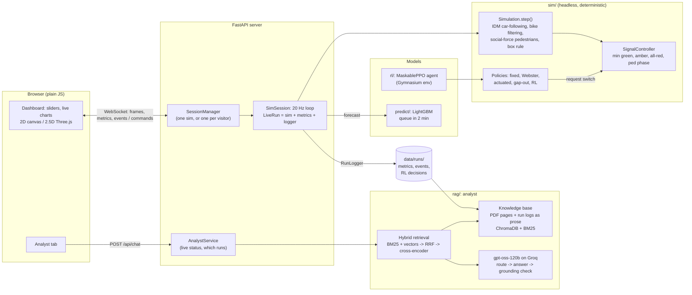
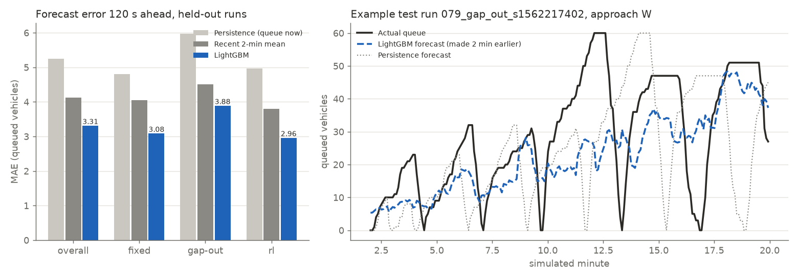
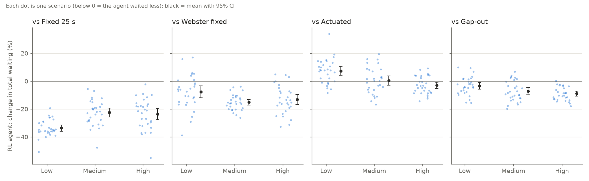

# Traffic Analyst

A road-junction simulator with mixed Indian traffic (cars, bikes, autos, buses, pedestrians), a
**reinforcement-learning** signal controller, a **LightGBM** queue forecaster and an **LLM analyst
(RAG)** that explains what happened, cites run logs and traffic-engineering manuals, and turns
plain-English scenarios into settings. Python backend (simulation written from scratch, no SUMO),
plain-JavaScript frontend with a 2.5D Three.js view.

**Headline results** (details below):
- AI signal control: **−27% total waiting** vs the fixed timer, −12% vs a Webster-timed plan, −7% vs
  gap-out over 90 paired scenarios (p < 0.001); a statistical tie with classic actuated control, but
  pedestrians wait 17% less.
- Capacity of the default junction: **1,790 ± 54 veh/h**.
- Queue forecast 2 minutes ahead: **37% lower error** than "same as now".
- Retrieval for the analyst: the passage a correct answer needs is found for **100%** of questions with
  hybrid search + re-ranking, vs 64% with vector search alone.

## Architecture



The simulation knows nothing about rendering, RL or the LLM: training runs headless and fast, the
dashboard only draws what the server streams, and every later phase reads the same run logs.

## Status
- [x] Phase 1: headless core sim (IDM car-following, fixed-time signals, left-hand traffic, deterministic)
- [x] Phase 2: metrics (queues, delay, throughput, LOS) + structured run logs in data/runs/
- [x] Phase 3: FastAPI + WebSocket dashboard (20 Hz stream, 2D canvas, sliders, live charts, mobile layout)
- [x] Phase 4: mixed Indian traffic (cars, bikes, autos, buses; bikes filter between lanes) and social-force
      pedestrians with an exclusive, on-demand pedestrian phase
- [x] Phase 5: 2.5D Three.js view (orthographic tilted camera, low-poly instanced vehicles, capsule
      pedestrians, procedural buildings, glowing signals, soft shadows) with a toggle back to the 2D view
- [x] Phase 6: stress test and capacity benchmark (`python -m bench`) plus a live stress test in the dashboard
- [x] Phase 7: RL signal controller (Gymnasium env + MaskablePPO), beats the fixed timer by 11–26% and a gap-out rule by 5–7%
- [x] Phase 8: AI in the dashboard: an AI on/off switch and a live side-by-side comparison with the fixed timer
- [x] Phase 9: LightGBM congestion predictor: each approach's queue 2 minutes ahead, 37% lower error than
      "same as now", drawn as dashed lines running ahead of the live queue chart
- [x] Phase 10: experiments: 5 controllers on the same 90 random scenarios. The AI beats the fixed timer (−27% waiting),
      a Webster-timed fixed timer (−12%) and gap-out (−7%), and ties with classic actuated control
- [x] Phase 11: knowledge base for the analyst: traffic-engineering PDFs + run logs in ChromaDB, hybrid search
      (BM25 + vectors, reciprocal rank fusion) with cross-encoder re-ranking and time-aware run search
- [x] Phase 12: the analyst chat (Analyst tab): explains runs and AI decisions with timestamped citations,
      answers guideline questions with page citations, turns plain-English scenarios into settings you confirm,
      says "I don't know", and checks every number in its answers against the sources
- [ ] Phase 13: RAG evaluation: 42 test questions + 11 scenario requests; retrieval comparison done
      (vector 64% / hybrid 97% / hybrid + re-ranker 100%); RAGAS scores running on the free tier
- [ ] Phase 14: polish: per-visitor sessions for a public demo, error-handling tests (173 tests), Docker image,
      this README; deployment to Google Cloud Run prepared, not yet live

## Quick start
```bash
python -m venv .venv
.venv/Scripts/activate        # Windows (use `source .venv/bin/activate` on macOS/Linux)
pip install torch --index-url https://download.pytorch.org/whl/cpu   # CPU-only PyTorch: much smaller
pip install -r requirements.txt
python -m server              # dashboard at http://127.0.0.1:8000 (the trained models are in the repo)
```

The analyst also needs a free Groq API key (`GROQ_API_KEY=...` in `.env`, see `.env.example`) and the
knowledge base: download the public-domain PDFs listed in `rag/sources.yaml` into `docs/`, then
`python -m rag.build`.

Everything else, regenerated from code:
```bash
python -m sim --duration 900  # headless run; logs to data/runs/<run_id>/ (use --no-log to skip)
python -m bench               # capacity benchmark (~70 s); results in experiments/results/benchmark/
python -m rl.train            # train the RL signal controller (~18 min on 14 cores)
python -m rl.evaluate         # compare it with the fixed timer and a gap-out rule on held-out seeds
python -m sim --controller rl # headless run with the trained agent
python -m predict.generate    # log 150 varied runs for the queue predictor (~90 s on 14 cores)
python -m predict.train_predictor  # train LightGBM on them (~15 s); the dashboard picks it up
python -m experiments         # 5 controllers x 90 random scenarios (~5 min on 14 cores; --quick to smoke-test)
python -m rag.build           # index docs/*.pdf + data/runs/ for the analyst (first run downloads 2 small models)
python -m rag.search "is a 120 s cycle too long?"   # try the knowledge base
python -m eval.run_rag_eval   # RAG evaluation (resumable; --until-done waits out the free tier's limits)
pytest -q                     # 173 tests, ~3 min
```

### Docker
```bash
docker build -t traffic-analyst .
docker run -p 7860:7860 -e GROQ_API_KEY=... traffic-analyst     # http://localhost:7860
```
The image is the public-demo configuration (`deploy/public.yaml`): it downloads the two public-domain
manuals (checksummed, because the analyst cites their page numbers), builds the search index and
caches both search models at build time, and gets the API key only as an environment variable.

## Dashboard
Press **Play** to start the simulation; sliders change demand, vehicle mix, pedestrians and
signal timing live. The junction opens in the **3D** view (drag to pan, wheel to zoom, Q/E or ⟲/⟳ to
rotate, **Fit** to reset); **2D** switches to the top-down debug view. Add `?view=2d` to the URL to
start in 2D, and press **F** for a frame-rate readout. If WebGL or the CDN is unavailable, the
dashboard stays in 2D.

Keyboard: **Space** play/pause · **A** AI on/off · **C** compare side by side · **/** ask the analyst · **Q/E** rotate (3D) ·
**F** frame-rate readout.

### AI in the dashboard
- **AI signal control** (switch, or press **A**) hands the running junction to the trained agent,
  and back, without restarting: the new controller takes over from the current state. The swap is
  logged as a `controller_change` event. Needs a trained model (`python -m rl.train`).
- **Compare side by side** (or **C**) restarts two junctions from empty at 0:00 with the same seed
  and settings, the fixed timer on the left and the AI on the right. They run in lockstep, every
  slider change reaches both at the same simulated instant, and both panes share one camera. The
  panel underneath says the result in words ("5% less waiting with the AI"), measured as
  `rl.evaluate` does, after a one-minute warm-up; differences under 1% count as "about the same".
  **Keep fixed timer** / **Keep AI** ends the comparison and keeps that junction running.

Why the comparison is fair: every random draw (arrivals, vehicle types, pedestrians) happens on
every step regardless of the signals, so both junctions see exactly the same traffic. A test runs
both and checks that their random generators end in a bit-identical state. Each side is logged as
its own run, tagged with a shared `compare_id`.

Live numbers swing early: a run that starts from an empty junction can show the AI behind for the
first few minutes before it settles near its held-out average (5–7% less waiting than gap-out,
11–26% less than the fixed timer; see below). One seed in the dashboard is a demo, not a result.

## Capacity benchmark
How much traffic can the junction handle? `python -m bench` steps demand up (+50 veh/h per approach
per level, each level a fresh 25-minute run) until an approach can no longer keep up, on three seeds.

| Junction | Signals | Capacity (sustained) | Breaks down at | Peak while overloaded |
|---|---|---|---|---|
| 4-way, 2+2 lanes per arm | fixed time, 25 s green | **1,790 ± 54 veh/h** | 500 veh/h per approach | ~2,070 veh/h |

"Breaks down" means oversaturation: an approach serves under 95% of the vehicles arriving, so its
queue grows without limit. The junction never literally gridlocks, because drivers don't enter the
box without room to leave it; the overflow queues outside instead. The **Run stress test** button
in the dashboard runs a quicker version on the live simulation to *show* the breakdown; its short
steps only catch clear overload, so the benchmark is the number to quote.

## RL signal controller
An AI agent decides, every 5 seconds, whether to keep the current green or switch to the next
phase. It is trained with reinforcement learning (MaskablePPO, Stable-Baselines3) on randomised
traffic, and rewarded for reducing the total time vehicles spend waiting. It can only *request* a
switch: minimum green, amber, all-red and the pedestrian phase are still enforced by the signal
controller, so a badly trained agent can be slow but never unsafe. Every decision is logged
(what it saw, what it chose, how confident it was) to `decisions.jsonl` in the run log, so the
analyst can later explain why it switched.

Train and evaluate it with:

```bash
python -m rl.train      # ~18 min on 14 cores -> rl/models/ppo_signal.zip + training curve
python -m rl.evaluate   # vs the fixed timer and gap-out on held-out seeds at low/medium/high demand
```

The training curve is drawn against two baselines on the same traffic: the fixed timer and a
simple "gap-out" rule (switch once the green's queue has cleared). It shows the agent twice: while
training (sampling actions to explore) and with its best action every 25k decisions, which is how
it runs when deployed. The best-action agent passes gap-out after ~50k decisions.


Held-out seeds 101–105, 15 minutes each, total vehicle waiting (fixed / gap-out / RL):

| Demand per approach | Fixed timer | Gap-out | RL agent | RL vs fixed | RL vs gap-out |
|---|---|---|---|---|---|
| 250 veh/h | 2.94 veh·h | 2.33 | **2.17** | −26% | −7% |
| 400 veh/h | 5.10 | 4.58 | **4.35** | −15% | −5% |
| 500 veh/h | 8.21 | 7.83 | **7.31** | −11% | −7% |

Trade-off: the reward only counts vehicles, so pedestrians wait longer than under gap-out
(e.g. 56 s vs 49 s at 500 veh/h), though still less than under the fixed timer (62 s).

## Congestion predictor
A LightGBM model forecasts how many vehicles will be queued on each approach **2 minutes from now**.
The dashboard draws the forecast as a dashed line in each approach's colour, running 2 minutes past
"now" on the queue chart; as time passes the solid line catches up, so you can see how good each
forecast was. (Hidden during a side-by-side comparison, whose charts show totals for two controllers.)

```bash
python -m predict.generate         # 150 logged runs, 20 min each, random traffic and controller
python -m predict.train_predictor  # -> predict/models/queue_lgbm.txt + a report in experiments/results/predict/
```

- **Data**: real run logs. The generator logs runs with the normal run logger into
  `data/predictor_runs/`, each with random demand, imbalance, pedestrians, green time, driver
  behaviour and vehicle mix, driven in turn by the fixed timer, the gap-out rule or the RL agent
  (the queue in 2 minutes depends on *who* changes the lights).
- **Features** (one sample = one approach at one second, one model for all approaches): this
  approach's queue now and 10–120 s ago, its backlog and arrivals, where it is in the signal cycle
  (phases until its green, seconds since its last green), the rest of the junction, and the
  current settings (demand, green time, pedestrian rate, controller). `predict/features.py` is used
  by both training and the dashboard, and a test checks they give identical features.
- **Split by run**: 90 training runs, 30 validation runs (early stopping), 30 test runs never seen.

Mean absolute error on the 30 held-out runs (queued vehicles, lower is better; mean queue 7.5):

| | Persistence ("same as now") | Recent 2-min mean | **LightGBM** |
|---|---|---|---|
| All test runs | 5.25 | 4.12 | **3.31** (−37%) |
| Fixed timer | 4.81 | 4.05 | **3.08** |
| Gap-out | 5.98 | 4.51 | **3.88** |
| RL agent | 4.97 | 3.80 | **2.96** |
| Demand > 450 veh/h (over capacity) | 10.27 | 7.42 | **6.07** |



The model's most useful inputs are the demand settings, then the signal-cycle position
(seconds since the approach's last green). It predicts the *level* of the queue well, but it rounds
off the sawtooth: when it can't be sure whether the light will have just turned green (queue near 0)
or be about to (queue at its peak), the error-minimising answer is in between. Full report:
[`experiments/results/predict/20261111-063145/report.md`](experiments/results/predict/20261111-063145/report.md).

## Experiments: which controller is best?
`python -m experiments` runs five signal controllers on the **same 90 random scenarios**: 30 in each
demand band (low 150–300, medium 300–420, high 420–550 veh/h per approach), each with random
per-approach imbalance (±30%), pedestrians (0–500/h), vehicle mix and seed. Each run is 5 minutes of
warm-up, then 20 minutes scored. That's 450 runs in ~5 minutes on 14 cores.

| Controller | What it is |
|---|---|
| Fixed 25 s | the config's plan: what the dashboard's fixed timer does |
| Webster fixed | a fixed plan re-timed for **each** scenario with Webster's formula, from its true demand and the saturation flow **measured** on this simulator (2,968 veh/h of green per approach) |
| Actuated | the classic rule real signals run: a detector covers the last 30 m before the stop line; the green is extended while it is occupied, ends after a 2 s gap, and never exceeds 60 s |
| Gap-out | Phase 7's rule: switch once the green approach has no queued vehicle (60 s cap) |
| RL agent | the trained PPO agent (with a 60 s max-green guard; see below) |

Because every controller faces the identical scenarios, the comparison is **paired**: for each
scenario, the AI's result is compared with each baseline's on exactly the same traffic.

**Total vehicle waiting, AI vs each baseline** (mean per-scenario change, 95% bootstrap CI, scenarios
won, Wilcoxon signed-rank p):

| Band | vs Fixed 25 s | vs Webster fixed | vs Actuated | vs Gap-out |
|---|---|---|---|---|
| Low | −33.7% [−35.9, −31.6], 30/30 | −7.6% [−11.9, −3.3], 22/30 | **+7.3%** [+4.3, +10.6], 8/30 | −3.4% [−5.7, −1.1], 22/30 |
| Medium | −22.5% [−25.8, −19.3], 30/30 | −15.1% [−17.1, −13.1], 30/30 | +0.4% [−3.0, +3.8], 14/30, p=0.67 | −7.3% [−9.8, −4.7], 23/30 |
| High | −23.6% [−27.7, −19.7], 30/30 | −13.3% [−16.8, −9.7], 27/30 | −3.0% [−5.2, −0.8], 21/30, p=0.06 | −8.9% [−10.7, −7.1], 29/30 |
| **All 90** | **−26.6%**, 90/90, p<0.001 | **−12.0%**, 79/90, p<0.001 | **+1.6%** [−0.3, +3.5], 43/90, p=0.58 | **−6.5%**, 74/90, p<0.001 |



What it shows:
- **The AI clearly beats both fixed timers and gap-out**, in every band. Even a fixed timer re-timed
  for the exact demand (Webster) waits 12% more on average.
- **Classic actuated control ties with the AI.** Actuated is better at low demand (its detector
  ends an empty green within ~2 s; the AI decides on a 5 s grid), they are level at medium demand,
  and the AI is slightly ahead near capacity (−3%, not quite significant). Overall the difference
  is +1.6% with p = 0.58: no evidence either is better at moving vehicles.
- **But actuated does it at the pedestrians' expense**: walkers wait 17% less under the AI
  (29% less at high demand), because actuated runs long greens (fewer, longer cycles), and the
  pedestrian phase only comes between greens. Gap-out is kindest to pedestrians (the AI's
  walkers wait 8% longer than under gap-out).

Mean ± standard deviation of every metric per band, the CSVs and the second plot are in
[`experiments/results/comparison/20261111-071045/report.md`](experiments/results/comparison/20261111-071045/report.md) (`runs.csv` one row per run, `summary.csv`, `paired.csv`,
`scenarios.json` with every scenario and Webster plan).

**A failure the experiment found, and the fix.** The first full run
([`experiments/results/comparison/20261111-070015_unguarded/`](experiments/results/comparison/20261111-070015_unguarded/report.md)) had one scenario at ~135% of capacity where the AI stopped switching:
one green ran for 16 minutes and it served 38% of demand (actuated: 62%). Every input the network
sees has a cap; in deep overload queues, backlogs and waits all read "maximum", every situation looks
the same, and it kept saying "keep". The deployed agent now has the same **60 s max-green guard** as
gap-out and actuated (the network still decides everything below 60 s; forced switches are logged as
such). With it the AI serves 64% in that scenario, and the other 89 scenarios are unchanged.

## Knowledge base (for the analyst)
The analyst (Phase 12) answers from two kinds of source, indexed together in ChromaDB:

- **Traffic-engineering documents**: every PDF under `docs/`. The catalogue `rag/sources.yaml` gives
  each a citation name and says where to download it; the PDFs themselves are not in git (most are
  copyrighted). Indexed so far: the FHWA *Traffic Signal Timing Manual* (2008) and *MUTCD 2009 Part 4*
  (both public domain), plus a local copy of Kadiyali's *Transportation Engineering* (Indian practice).
  Pages are cleaned (running headers, tables of contents, OCR junk), cut into ~200-word passages
  that never cross a page, and cited with the page number **as printed** ("FHWA Signal Timing
  Manual, p. 6-28") and the section they belong to.
- **Simulation runs**: every run in `data/runs/`, turned into prose (the embedding model reads
  English, not CSV): an overview per run, one chunk per minute (signals, queues per approach with
  peaks and times, arrivals, delay, LOS, every event in words), and one chunk per minute of the RL
  agent's decisions (what it saw, what it chose, how sure it was). Every number comes from the
  log. Cited as "run <id> @ 3:00-4:00".

Retrieval is **hybrid**: BM25 (exact words: section numbers, "spillback", clock times) and vector
search (meaning: all-MiniLM-L6-v2) each return 30 candidates, **reciprocal rank fusion** merges the two
rankings, and a **cross-encoder** (ms-marco-MiniLM-L-6-v2) re-reads the top 30 with the question and
keeps the best 5. A question that names a time ("why did the AI switch at 1:35?", "minute 4") puts
the run windows covering that time first: timestamps are matched exactly, not by similarity. About
0.7 s per question on a CPU once the models are loaded (11 ms without the re-ranker).

```bash
python -m rag.build                     # incremental: only new or changed PDFs and runs are re-indexed
python -m rag.search "how long should the pedestrian clearance interval be"
python -m rag.search "why did the AI switch at 1:35?" --run 20261108-140830_rl_s42
python -m rag.search "PCU values for two-wheelers" --source doc --mode hybrid   # modes: vector, bm25, hybrid, hybrid_rerank
```

## The analyst (chat)
The **Analyst** tab next to the Dashboard tab (or press **/**, or open `/?tab=analyst`) answers questions
about the junction you are watching. It needs a free Groq API key in `.env` (`GROQ_API_KEY=...`, see
`.env.example`) and the knowledge base (`python -m rag.build`). The model is OpenAI's open-weight
**gpt-oss-120b** served by Groq (Groq retired its Llama 3 chat models), with gpt-oss-20b as the fallback
when the free tier's rate limit (~8,000 tokens a minute, about two questions) is reached.

| You ask | It does |
|---|---|
| "What happened in the last minute?" / "Why did the queue on N grow at 3:20?" | Searches the **live run's log** (brought up to date before each question) and answers with timestamped citations: `[2] run … @ 3:00-4:00` |
| "Why did the AI switch at 1:35?" | Answers from the **logged decision**: what the agent saw per approach, its P(switch), the signal state |
| "Is a 120 s cycle too long?" | Answers from the **documents** with page citations (FHWA Signal Timing Manual p. 6-28) |
| "Is the cycle too long here?" | Combines both, including the **measured** cycle of the last 5 minutes (under the AI it isn't the plan's) |
| "Evening rush, 60% bikes, school crossing" | Proposes **settings** (validated against the slider limits) as a card with its assumptions; nothing changes until you press **Apply** |
| "What was the buses' average speed?" | "I don't know": the logs don't record speeds by type |

How an answer is made: a short call **routes** the question (run / AI decision / guideline / both / scenario)
and rewrites follow-ups ("and at 4:00?") into standalone questions; relative times ("the last 3 minutes")
are turned into m:ss ranges in code. The hybrid search then fetches sources (the live run, or a run the
question names; documents; a **live status** source with the current settings, measured signal timing and
queues). The model answers from those numbered sources only. Finally a **grounding check** looks for
every number of the answer in the sources: if one is missing, the model gets one chance to fix it, and
anything still unsupported is shown under the answer ("Not found in the sources: …") instead of passing
as fact. Every exchange is logged to `data/analyst/log.jsonl` (question, sources, answer, check result).

## RAG evaluation
`eval/rag_test_questions.json` holds **42 questions with ground-truth answers**, in the brief's four
types, plus 11 scenario requests:

| Type | # | Answered from | Example |
|---|---|---|---|
| Run | 12 | a fixed-timer evaluation run | "What was the worst queue on approach N in this run, and when?" |
| AI decision | 12 | an RL evaluation run | "Why did the AI switch at 1:35?" |
| Guideline | 12 | the three manuals | "What walking speed is used to time the pedestrian clearance interval?" |
| Unanswerable | 6 | — (must say "I don't know") | "How much CO2 did the traffic emit during this run?" |
| Scenario | 11 | — (checked against rules) | "Evening rush, 60% bikes, school crossing" |

The two runs are regenerated bit-identically from a seed (`eval/runs.py` checks their fingerprints),
and every question lists the passages a correct answer needs (a page of a manual, or a minute of a run).

**Retrieval: vector vs hybrid vs hybrid + re-ranker** (the 36 run, decision and guideline questions;
no LLM involved, so it is exact and free):

| Retrieval | Needed passage found (top 5) | Mean reciprocal rank |
|---|---|---|
| Vector only | 64% | 0.34 |
| Hybrid (BM25 + vectors, RRF) | 97% | 0.76 |
| **Hybrid + cross-encoder** | **100%** | **0.86** |

Vector search alone fails mostly on questions tied to a moment ("at 1:35"): embeddings barely register
timestamps, while BM25 matches "4:05" exactly and the time-aware search puts that minute first. The
hybrid's one miss (MUTCD p. 489, red clearance) is recovered by the re-ranker.

**RAGAS** (faithfulness, answer relevancy, context precision, context recall) scores the deployed
setup's answers (gpt-oss-120b, hybrid + re-ranker) with gpt-oss-20b as the judge. On Groq's free
tier (~200k tokens per model per day) this takes a few days, so the run is resumable and waits out
the limits by itself; the scores go here when it finishes. Why not RAGAS for all three retrieval
modes: that triples the answers and judgements (~3 weeks on the free tier), and retrieval quality is
measured exactly by the table above.

## Public demo: one sim per visitor
Locally, every browser shares one simulation. A public link can't work that way (strangers would move
each other's sliders), so the demo configuration (`deploy/public.yaml`, loaded on top of `config.yaml`
via `TRAFFIC_OVERLAY`) gives **each browser tab its own simulation**: at most 4 at once (a fifth visitor
sees "demo busy" and retries), a reload reconnects to the same sim, and a sim closes 2 minutes after
its tab, deleting its run logs. The heavy models (RL network, predictor, search models) are loaded
once and shared. The analyst allows 10 questions per visitor per hour, to keep the free Groq quota
for everyone, and a visitor can only ask about their own runs.

Deployment target: **Google Cloud Run** (`python -m deploy.cloudrun <project-id>`): the same Docker
image, scaled to zero when nobody visits, capped at one instance (the sessions live in its memory),
with the Groq key in Secret Manager. Hugging Face Spaces (the brief's option) now charges for Docker
Spaces, and Render's free tier (512 MB) can't hold PyTorch plus the search models.

## Limitations
- **One junction layout** (4 arms, 2 lanes in and out) and **simplified behaviour**: no lane changes
  between approach lanes, no U-turns, pedestrians separated from vehicles by rules rather than forces.
  The simulator is calibrated to be plausible, not validated against real Indian traffic counts.
- **The RL agent** was trained on this layout only and decides on a 5 s grid, so classic actuated
  control (2 s gap-out) still wins at low demand. Its reward ignores pedestrians, who wait longer than
  under gap-out. Deep overload needed a hand-written 60 s max-green guard (its inputs saturate).
- **The predictor** gets the queue level right but rounds off the signal sawtooth, and was trained only
  on simulated runs from this junction.
- **The analyst** depends on a free-tier LLM (~8,000 tokens a minute, so 3–7 s per answer and a
  daily cap), only knows three manuals (two of them US), and its grounding check catches invented
  numbers, not wrong reasoning about correct ones. The RAGAS judge is itself an LLM.
- **The public demo** keeps sessions in one process's memory (one instance), the per-visitor question
  limit trusts the X-Forwarded-For header, and a cold start takes ~30 s.

## Key learnings
- **Determinism pays for itself.** One seeded random generator and fixed iteration order made runs
  bit-identical, which made paired experiments, fair side-by-side comparisons and regression tests
  possible, and turned "flaky" bugs into reproducible ones.
- **Make the safety layer separate from the smart layer.** The RL agent can only *request* a switch;
  min green, amber, all-red and the pedestrian phase stay with the signal controller. A bad policy can
  be slow, never unsafe, and the same holds for every baseline.
- **Baselines decide whether a result means anything.** Beating a fixed timer by 27% sounds great;
  the honest finding is a tie with classic actuated control. The experiment also exposed the agent's
  overload lock-up, which a single demo run never showed.
- **Test what the model sees, not what you think it sees.** Training/deployment parity tests (RL
  observations, predictor features) caught drift, and a logged-value bug (green time read after the
  switch) was found only by reading the logs back.
- **Retrieval before generation.** Most analyst failures were retrieval failures: embeddings ignore
  timestamps, so time-aware search and BM25 mattered more than prompt wording. Measuring retrieval
  directly (no LLM) was cheaper and more exact than LLM-judged metrics.
- **Don't trust a prompt to enforce a rule.** "Never invent numbers" is a request; the grounding check
  is a guarantee. Likewise, relative times are computed in code, not by the model.
- **Free tiers shape the design.** Token limits set the source budget per answer, the evaluation had
  to be cached and resumable, and the deployment target changed when a free tier disappeared.
