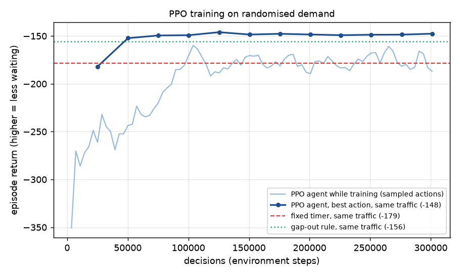

# Traffic Analyst

A road-junction simulator with reinforcement-learning signal control and an LLM (RAG) analyst.
Work in progress. The full README (architecture diagram, results, learnings) comes in Phase 14.

## Status
- [x] Phase 1: headless core sim (IDM car-following, fixed-time signals, left-hand traffic, deterministic)
- [x] Phase 2: metrics (queues, delay, throughput, LOS) + structured run logs in data/runs/
- [x] Phase 3: FastAPI + WebSocket dashboard (20 Hz stream, 2D canvas, sliders, live charts, mobile layout)
- [x] Phase 4: mixed Indian traffic (cars, bikes, autos, buses; bikes filter between lanes) and social-force
      pedestrians with an exclusive, on-demand pedestrian phase
- [x] Phase 5: 2.5D Three.js view (orthographic tilted camera, low-poly instanced vehicles, capsule
      pedestrians, procedural buildings, glowing signals, soft shadows) with a toggle back to the 2D view
- [x] Phase 6: stress test and capacity benchmark (`python -m bench`) plus a live stress test in the dashboard
- [x] Phase 7: RL signal controller (Gymnasium env + MaskablePPO), beats the fixed timer by 11–26% and a gap-out rule by 5–7%
- [x] Phase 8: AI in the dashboard: an AI on/off switch and a live side-by-side comparison with the fixed timer
- [x] Phase 9: LightGBM congestion predictor: each approach's queue 2 minutes ahead, 37% lower error than
      "same as now", drawn as dashed lines running ahead of the live queue chart

## Quick start
```bash
python -m venv .venv
.venv/Scripts/activate        # Windows (use `source .venv/bin/activate` on macOS/Linux)
pip install torch --index-url https://download.pytorch.org/whl/cpu   # CPU-only PyTorch: much smaller
pip install -r requirements.txt
python -m sim --duration 900  # headless run; logs to data/runs/<run_id>/ (use --no-log to skip)
python -m server              # dashboard at http://127.0.0.1:8000
python -m bench               # capacity benchmark (~70 s); results in experiments/results/benchmark/
python -m rl.train            # train the RL signal controller (~18 min on 14 cores)
python -m rl.evaluate         # compare it with the fixed timer and a gap-out rule on held-out seeds
python -m sim --controller rl # headless run with the trained agent
python -m predict.generate    # log 150 varied runs for the queue predictor (~90 s on 14 cores)
python -m predict.train_predictor  # train LightGBM on them (~15 s); the dashboard picks it up
pytest -q
```

## Dashboard
Press **Play** to start the shared simulation; sliders change demand, vehicle mix, pedestrians and
signal timing live. The junction opens in the **3D** view (drag to pan, wheel to zoom, Q/E or ⟲/⟳ to
rotate, **Fit** to reset); **2D** switches to the top-down debug view. Add `?view=2d` to the URL to
start in 2D, and press **F** for a frame-rate readout. If WebGL or the CDN is unavailable, the
dashboard stays in 2D.

Keyboard: **Space** play/pause · **A** AI on/off · **C** compare side by side · **Q/E** rotate (3D) ·
**F** frame-rate readout.

### AI in the dashboard
- **AI signal control** (switch, or press **A**) hands the running junction to the trained agent,
  and back, without restarting: the new controller takes over from the current state. The swap is
  logged as a `controller_change` event. Needs a trained model (`python -m rl.train`).
- **Compare side by side** (or **C**) restarts two junctions from empty at 0:00 with the same seed
  and settings, the fixed timer on the left and the AI on the right. They run in lockstep, every
  slider change reaches both at the same simulated instant, and both panes share one camera. The
  panel underneath says the result in words ("5% less waiting with the AI"), measured as
  `rl.evaluate` does, after a one-minute warm-up; differences under 1% count as "about the same".
  **Keep fixed timer** / **Keep AI** ends the comparison and keeps that junction running.

Why the comparison is fair: every random draw (arrivals, vehicle types, pedestrians) happens on
every step regardless of the signals, so both junctions see exactly the same traffic. A test runs
both and checks that their random generators end in a bit-identical state. Each side is logged as
its own run, tagged with a shared `compare_id`.

Live numbers swing early: a run that starts from an empty junction can show the AI behind for the
first few minutes before it settles near its held-out average (5–7% less waiting than gap-out,
11–26% less than the fixed timer; see below). One seed in the dashboard is a demo, not a result.

## Capacity benchmark
How much traffic can the junction handle? `python -m bench` steps demand up (+50 veh/h per approach
per level, each level a fresh 25-minute run) until an approach can no longer keep up, on three seeds.

| Junction | Signals | Capacity (sustained) | Breaks down at | Peak while overloaded |
|---|---|---|---|---|
| 4-way, 2+2 lanes per arm | fixed time, 25 s green | **1,790 ± 54 veh/h** | 500 veh/h per approach | ~2,070 veh/h |

"Breaks down" means oversaturation: an approach serves under 95% of the vehicles arriving, so its
queue grows without limit. The junction never literally gridlocks, because drivers don't enter the
box without room to leave it; the overflow queues outside instead. The **Run stress test** button
in the dashboard runs a quicker version on the live simulation to *show* the breakdown; its short
steps only catch clear overload, so the benchmark is the number to quote.

## RL signal controller
An AI agent decides, every 5 seconds, whether to keep the current green or switch to the next
phase. It is trained with reinforcement learning (MaskablePPO, Stable-Baselines3) on randomised
traffic, and rewarded for reducing the total time vehicles spend waiting. It can only *request* a
switch: minimum green, amber, all-red and the pedestrian phase are still enforced by the signal
controller, so a badly trained agent can be slow but never unsafe. Every decision is logged
(what it saw, what it chose, how confident it was) to `decisions.jsonl` in the run log, so the
analyst can later explain why it switched.

Train and evaluate it with:

```bash
python -m rl.train      # ~18 min on 14 cores -> rl/models/ppo_signal.zip + training curve
python -m rl.evaluate   # vs the fixed timer and gap-out on held-out seeds at low/medium/high demand
```

The training curve is drawn against two baselines on the same traffic: the fixed timer and a
simple "gap-out" rule (switch once the green's queue has cleared). It shows the agent twice: while
training (sampling actions to explore) and with its best action every 25k decisions, which is how
it runs when deployed. The best-action agent passes gap-out after ~50k decisions.



Held-out seeds 101–105, 15 minutes each, total vehicle waiting (fixed / gap-out / RL):

| Demand per approach | Fixed timer | Gap-out | RL agent | RL vs fixed | RL vs gap-out |
|---|---|---|---|---|---|
| 250 veh/h | 2.94 veh·h | 2.33 | **2.17** | −26% | −7% |
| 400 veh/h | 5.10 | 4.58 | **4.35** | −15% | −5% |
| 500 veh/h | 8.21 | 7.83 | **7.31** | −11% | −7% |

Trade-off: the reward only counts vehicles, so pedestrians wait longer than under gap-out
(e.g. 56 s vs 49 s at 500 veh/h), though still less than under the fixed timer (62 s).

## Congestion predictor
A LightGBM model forecasts how many vehicles will be queued on each approach **2 minutes from now**.
The dashboard draws the forecast as a dashed line in each approach's colour, running 2 minutes past
"now" on the queue chart; as time passes the solid line catches up, so you can see how good each
forecast was. (Hidden during a side-by-side comparison, whose charts show totals for two controllers.)

```bash
python -m predict.generate         # 150 logged runs, 20 min each, random traffic and controller
python -m predict.train_predictor  # -> predict/models/queue_lgbm.txt + a report in experiments/results/predict/
```

- **Data**: real run logs. The generator logs runs with the normal run logger into
  `data/predictor_runs/`, each with random demand, imbalance, pedestrians, green time, driver
  behaviour and vehicle mix, driven in turn by the fixed timer, the gap-out rule or the RL agent
  (the queue in 2 minutes depends on *who* changes the lights).
- **Features** (one sample = one approach at one second, one model for all approaches): this
  approach's queue now and 10–120 s ago, its backlog and arrivals, where it is in the signal cycle
  (phases until its green, seconds since its last green), the rest of the junction, and the
  current settings (demand, green time, pedestrian rate, controller). `predict/features.py` is used
  by both training and the dashboard, and a test checks they give identical features.
- **Split by run**: 90 training runs, 30 validation runs (early stopping), 30 test runs never seen.

Mean absolute error on the 30 held-out runs (queued vehicles, lower is better; mean queue 7.5):

| | Persistence ("same as now") | Recent 2-min mean | **LightGBM** |
|---|---|---|---|
| All test runs | 5.25 | 4.12 | **3.31** (−37%) |
| Fixed timer | 4.81 | 4.05 | **3.08** |
| Gap-out | 5.98 | 4.51 | **3.88** |
| RL agent | 4.97 | 3.80 | **2.96** |
| Demand > 450 veh/h (over capacity) | 10.27 | 7.42 | **6.07** |


The model's most useful inputs are the demand settings, then the signal-cycle position
(seconds since the approach's last green). It predicts the *level* of the queue well, but it rounds
off the sawtooth: when it can't be sure whether the light will have just turned green (queue near 0)
or be about to (queue at its peak), the error-minimising answer is in between. Full report:
[`experiments/results/predict/20261111-063145/report.md`](experiments/results/predict/20261111-063145/report.md).

