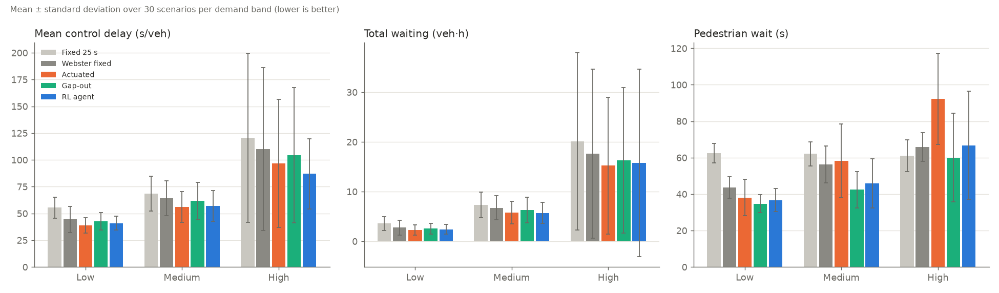
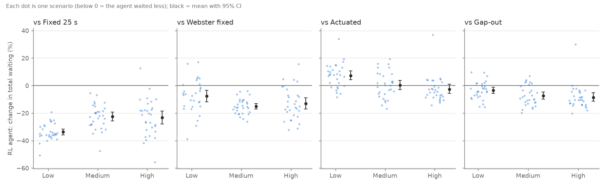

# Signal controllers compared across random scenarios

90 scenarios (30 per demand band: low 150–300, medium 300–420, high 420–550 veh/h per approach, each approach x U(0.7, 1.3), pedestrians U(0, 500)/h, random vehicle mix and seed). Every controller ran the same scenarios: 300 s warm-up, then 1200 s scored. Commit `6123eb3`, 450 runs in 5.0 min.

Webster plans use the measured saturation flow of **2,968 veh/h of green per approach** (mixed traffic; probe at 1200 veh/h, 40 s greens).

## Results by demand band (mean ± standard deviation over scenarios)

### Low demand (150–300 veh/h per approach)

| Controller | Total waiting (veh·h) | Mean control delay (s/veh) | Demand served (%) | Worst queue on an approach (veh) | Pedestrian wait (s) | Greens per hour |
|---|---:|---:|---:|---:|---:|---:|
| Fixed 25 s | 3.60 ± 1.39 | 55.5 ± 9.8 | 99.5 ± 1.8 | 13.9 ± 4.6 | 62.4 ± 5.3 | 100.0 ± 4.0 |
| Webster fixed | 2.73 ± 1.46 | 44.5 ± 12.2 | **100.5 ± 1.9** | 11.1 ± 3.4 | 43.7 ± 5.9 | 153.7 ± 32.5 |
| Actuated | **2.29 ± 1.01** | **39.0 ± 7.2** | 100.4 ± 2.3 | 10.7 ± 3.7 | 38.1 ± 10.1 | 173.1 ± 29.6 |
| Gap-out | 2.53 ± 1.11 | 42.5 ± 8.2 | 100.4 ± 2.2 | 11.0 ± 3.4 | **34.7 ± 4.9** | 176.4 ± 17.2 |
| RL agent | 2.41 ± 0.96 | 40.9 ± 6.5 | 100.3 ± 2.1 | **10.2 ± 2.6** | 36.7 ± 6.2 | 172.1 ± 19.0 |

### Medium demand (300–420 veh/h per approach)

| Controller | Total waiting (veh·h) | Mean control delay (s/veh) | Demand served (%) | Worst queue on an approach (veh) | Pedestrian wait (s) | Greens per hour |
|---|---:|---:|---:|---:|---:|---:|
| Fixed 25 s | 7.32 ± 2.53 | 68.5 ± 16.4 | 98.7 ± 2.0 | 23.6 ± 7.3 | 62.1 ± 6.7 | 100.0 ± 2.7 |
| Webster fixed | 6.72 ± 2.43 | 64.1 ± 16.3 | 99.6 ± 2.2 | 21.4 ± 5.4 | 56.3 ± 10.2 | 113.7 ± 16.6 |
| Actuated | 5.77 ± 2.30 | **56.1 ± 14.3** | **100.2 ± 2.0** | 20.3 ± 5.7 | 58.3 ± 20.3 | 117.3 ± 31.8 |
| Gap-out | 6.26 ± 2.57 | 61.6 ± 17.6 | 100.0 ± 2.2 | 19.3 ± 4.8 | **42.4 ± 10.0** | 153.2 ± 26.6 |
| RL agent | **5.71 ± 2.13** | 56.9 ± 14.4 | 100.1 ± 2.0 | **19.0 ± 4.6** | 45.9 ± 13.5 | 142.2 ± 28.2 |

### High demand (420–550 veh/h per approach)

| Controller | Total waiting (veh·h) | Mean control delay (s/veh) | Demand served (%) | Worst queue on an approach (veh) | Pedestrian wait (s) | Greens per hour |
|---|---:|---:|---:|---:|---:|---:|
| Fixed 25 s | 20.10 ± 17.84 | 120.5 ± 79.0 | 91.9 ± 10.9 | 43.5 ± 15.1 | 61.1 ± 8.8 | 100.6 ± 2.3 |
| Webster fixed | 17.60 ± 16.99 | 110.2 ± 76.1 | 94.2 ± 10.0 | 37.5 ± 12.0 | 65.9 ± 7.9 | 96.3 ± 2.3 |
| Actuated | **15.24 ± 13.76** | 96.7 ± 59.7 | **96.2 ± 7.6** | 38.1 ± 12.2 | 92.2 ± 25.0 | 75.3 ± 17.6 |
| Gap-out | 16.27 ± 14.63 | 104.4 ± 63.2 | 95.3 ± 8.2 | 35.6 ± 10.4 | **60.0 ± 24.2** | 114.5 ± 28.5 |
| RL agent | 15.75 ± 18.88 | **86.9 ± 32.6** | 95.5 ± 11.7 | **33.7 ± 9.8** | 66.8 ± 29.7 | 103.8 ± 33.6 |

### All scenarios

| Controller | Total waiting (veh·h) | Mean control delay (s/veh) | Demand served (%) | Worst queue on an approach (veh) | Pedestrian wait (s) | Greens per hour |
|---|---:|---:|---:|---:|---:|---:|
| Fixed 25 s | 10.34 ± 12.52 | 81.5 ± 54.3 | 96.7 ± 7.3 | 27.0 ± 15.8 | 61.9 ± 7.0 | 100.2 ± 3.0 |
| Webster fixed | 9.02 ± 11.69 | 72.9 ± 52.8 | 98.1 ± 6.6 | 23.3 ± 13.4 | 55.4 ± 12.2 | 121.2 ± 31.9 |
| Actuated | **7.76 ± 9.70** | 63.9 ± 42.9 | **98.9 ± 5.1** | 23.0 ± 13.9 | 63.2 ± 29.6 | 121.9 ± 48.4 |
| Gap-out | 8.35 ± 10.31 | 69.5 ± 45.8 | 98.6 ± 5.5 | 22.0 ± 12.3 | **45.8 ± 18.7** | 148.0 ± 35.4 |
| RL agent | 7.96 ± 12.27 | **61.6 ± 28.2** | 98.6 ± 7.2 | **21.0 ± 11.6** | 50.0 ± 22.8 | 139.4 ± 39.2 |

Bold = best mean in that column.

## RL agent vs each baseline, scenario by scenario

Per-scenario change in the metric (negative = the agent is better), mean with a 95% bootstrap confidence interval, scenarios where the agent was better, and the Wilcoxon signed-rank p-value (a small p means the difference is consistent across scenarios, not chance).

### Total waiting

| Band | vs Fixed 25 s | vs Webster fixed | vs Actuated | vs Gap-out |
|---|---|---|---|---|
| low | -33.7% [-35.9, -31.6], 30/30, p=<0.001 | -7.6% [-11.9, -3.3], 22/30, p=<0.001 | +7.3% [+4.3, +10.6], 8/30, p=<0.001 | -3.4% [-5.7, -1.1], 22/30, p=0.004 |
| medium | -22.5% [-25.8, -19.3], 30/30, p=<0.001 | -15.1% [-17.1, -13.1], 30/30, p=<0.001 | +0.4% [-3.0, +3.8], 14/30, p=0.666 | -7.3% [-9.8, -4.7], 23/30, p=<0.001 |
| high | -23.2% [-27.9, -18.4], 29/30, p=<0.001 | -13.0% [-17.0, -8.8], 26/30, p=<0.001 | -2.7% [-5.6, +1.0], 22/30, p=0.005 | -8.6% [-11.3, -5.2], 28/30, p=<0.001 |
| all | -26.5% [-28.7, -24.2], 89/90, p=<0.001 | -11.9% [-14.1, -9.7], 78/90, p=<0.001 | +1.7% [-0.4, +3.8], 44/90, p=0.283 | -6.4% [-8.0, -4.8], 73/90, p=<0.001 |

### Mean control delay

| Band | vs Fixed 25 s | vs Webster fixed | vs Actuated | vs Gap-out |
|---|---|---|---|---|
| low | -26.1% [-28.0, -24.2], 30/30, p=<0.001 | -5.8% [-9.5, -2.4], 22/30, p=0.003 | +5.6% [+3.4, +7.9], 5/30, p=<0.001 | -3.1% [-5.0, -1.3], 22/30, p=0.003 |
| medium | -17.0% [-19.5, -14.4], 30/30, p=<0.001 | -11.0% [-12.8, -9.3], 30/30, p=<0.001 | +1.7% [-0.9, +4.4], 13/30, p=0.490 | -6.5% [-8.7, -4.3], 24/30, p=<0.001 |
| high | -20.5% [-25.7, -16.1], 30/30, p=<0.001 | -13.0% [-18.7, -8.4], 25/30, p=<0.001 | -4.0% [-9.4, -0.4], 20/30, p=0.052 | -11.1% [-16.0, -7.9], 30/30, p=<0.001 |
| all | -21.2% [-23.4, -19.2], 90/90, p=<0.001 | -10.0% [-12.3, -7.9], 77/90, p=<0.001 | +1.1% [-1.2, +3.0], 38/90, p=0.385 | -6.9% [-8.9, -5.3], 76/90, p=<0.001 |

### Pedestrian wait

| Band | vs Fixed 25 s | vs Webster fixed | vs Actuated | vs Gap-out |
|---|---|---|---|---|
| low | -41.0% [-43.9, -37.4], 29/29, p=<0.001 | -15.2% [-19.6, -10.1], 26/29, p=<0.001 | -1.0% [-6.2, +4.5], 19/29, p=0.238 | +6.3% [+2.1, +10.5], 5/29, p=0.004 |
| medium | -25.9% [-33.3, -18.4], 26/30, p=<0.001 | -17.9% [-25.1, -9.9], 25/30, p=<0.001 | -19.5% [-23.9, -15.1], 29/30, p=<0.001 | +7.8% [+2.8, +13.0], 9/30, p=0.013 |
| high | +8.6% [-6.9, +25.0], 17/30, p=0.984 | +0.5% [-14.0, +16.5], 16/30, p=0.349 | -27.4% [-35.5, -18.7], 26/30, p=<0.001 | +11.6% [+2.8, +21.8], 8/30, p=0.002 |
| all | -19.2% [-26.3, -11.3], 72/89, p=<0.001 | -10.8% [-16.7, -4.4], 67/89, p=<0.001 | -16.1% [-20.4, -11.8], 74/89, p=<0.001 | +8.6% [+4.9, +12.6], 22/89, p=<0.001 |

