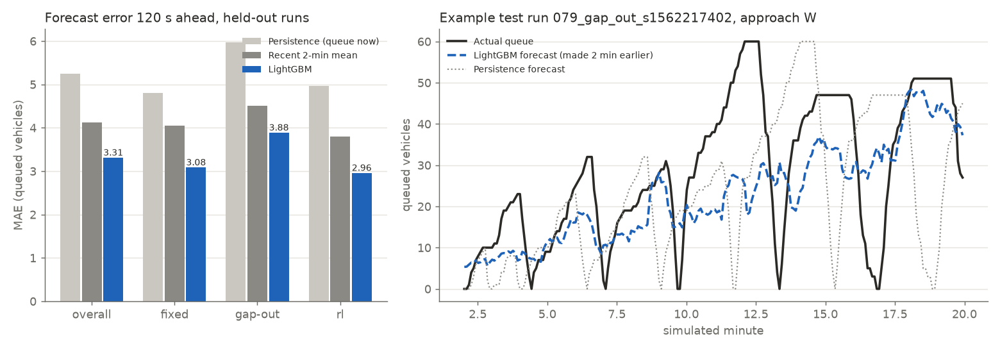

# Queue predictor: 120 s ahead

Trained 2026-11-11T06:31:45+00:00 on 90 runs (validation 30, test 30), commit `5227385+dirty`. 824 trees (early stopping on the validation runs), objective `l1`.

Target: queued vehicles (below 2 m/s) on one approach, 2 minutes after the forecast is made. Mean actual queue in the test set: 7.54 vehicles. All numbers are mean absolute errors (MAE, vehicles) on the held-out test runs; lower is better.

## Overall

| | samples | persistence | recent 2-min mean | LightGBM | LightGBM vs persistence |
|---|---:|---:|---:|---:|---:|
| all test samples | 25,920 | 5.25 | 4.12 | **3.31** | 37% |

## By controller

| | samples | persistence | recent 2-min mean | LightGBM | LightGBM vs persistence |
|---|---:|---:|---:|---:|---:|
| fixed | 8,640 | 4.81 | 4.05 | **3.08** | 36% |
| gap_out | 8,640 | 5.98 | 4.51 | **3.88** | 35% |
| rl | 8,640 | 4.97 | 3.80 | **2.96** | 40% |

## By demand (mean per approach)

| | samples | persistence | recent 2-min mean | LightGBM | LightGBM vs persistence |
|---|---:|---:|---:|---:|---:|
| low (<300 veh/h) | 10,368 | 2.38 | 1.93 | **1.42** | 41% |
| medium (300-450) | 7,776 | 4.06 | 3.75 | **3.07** | 24% |
| high (>450, over capacity) | 7,776 | 10.27 | 7.42 | **6.07** | 41% |

## Most used features (share of total gain)

| feature | gain |
|---|---:|
| demand_vph | 30.6% |
| demand_others_vph | 9.9% |
| secs_since_green | 8.6% |
| green_s | 6.5% |
| green_share120 | 5.2% |
| controller | 4.3% |
| queue_mean120 | 3.5% |
| ped_rate_ph | 3.4% |
| queue_now | 2.9% |
| queue_others | 2.5% |
| wait_now | 2.3% |
| phases_until_green | 2.2% |

